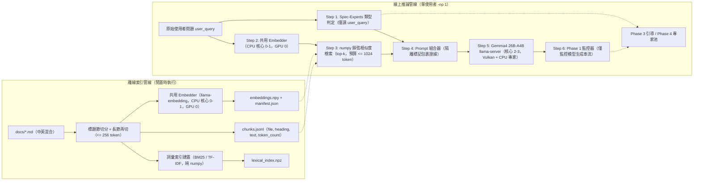

<!-- ── Antigravity BEGIN: E06 RAG 架構規劃文件 / E06 RAG architecture specification ── -->
# 受限硬體上之本地 RAG 架構規劃（方向 B：回答精準度）

日期：2026-11-19。對應規劃文件：`docs/embedding_research_plan_2026-11-19.md`（切片 E06）。性質：純架構與介面規劃文件（本切片不含程式碼實作）。

## 1. 目標、範圍與預先登記判準

本文件定義方向 B（以小型 embedder 進行本地檢索增強生成，RAG）在資源受限硬體上的系統架構、GT 1030 記憶體與頻寬預算、與 Spec-Experts 既有模組的介面契約（包含檢索內容對區塊類型標籤的影響界線），以及預期失敗模式與防護機制。

### 1.1 預先登記之假設與門檻

以下數值與判讀規則全部沿用 `docs/embedding_research_plan_2026-11-19.md` §3，不做任何調整：

| 編號 | 假設項目 | 預先登記門檻（來源：`docs/embedding_research_plan_2026-11-19.md` §3） | 判讀措辭 |
|---|---|---|---|
| H4c | Embedder 受限環境成本 | 2 核（核心 0–1 內）每 chunk 延遲 ≤ 1.0 s、常駐記憶體（RSS）≤ 300 MiB、GPU 使用量 0 MiB | 達成／未達成，附實測值 |
| H6-檢索 | RAG 檢索命中率 | 檢索 `hit@3 ≥ 0.85`，且高於 BM25／TF-IDF 詞彙基準 `≥ +0.05` | 與下方端到端條件合判：兩類皆達成＝支持；僅一類＝部分支持；皆未達成＝尚未觀察到優勢 |
| H6-端到端 | RAG 事實題正確率 | `N = 24` 題（中英各半）關鍵事實正確率「有檢索 − 無檢索」`≥ +0.20` | 同上 |
| H6-預算 | Prompt 增量上限 | 每題新增 prompt `≤ 1024 token` | 硬性預算上限 |

### 1.2 硬體與模型操作環境

| 項目 | 目標部署環境（GT 1030） | 實驗模擬環境（`gx10_sim`） | 來源 |
|---|---|---|---|
| CPU 與配額 | Intel i5-4460（4C/4T，3.2 GHz）；`llama-server` 鎖定核心 2–3、`below_normal`、`threads=2`；Python 與檢索使用核心 0–1 | 核心 0–4、`nice 10`、`load1 ≤ 6.0`、單一行程；E04 embedder 量測使用核心 0–1 | `README.md`、`config/machines/gt1030_win.json`、`config/machines/gx10_sim.json`、`docs/embedding_research_plan_2026-11-19.md` §2、§6 |
| GPU 與 VRAM 預算 | NVIDIA GT 1030（2,048 MiB GDDR5）；桌面合成器基線佔用 452 MiB；配置目標 1,500 MiB、上限 1,700 MiB | 受限模擬配置目標 750 MiB、上限 1,000 MiB（`-ngl 2 -ub 64`，實測 933 MiB） | `docs/gemma4_26b_a4b_vram_benchmark.md`、`config/machines/gt1030_win.json`、`config/machines/gx10_sim.json`、`docs/thesis_zh.md` §4.1 |
| 系統 RAM 與頻寬 | 34 GB DDR3-1600（34,816 MiB，雙通道標稱頻寬 17 GB/s） | 系統記憶體 121 GB（可用約 45 GB） | `docs/gemma4_26b_a4b_vram_benchmark.md`、`docs/thesis_zh.md` §4.1、`docs/embedding_research_plan_2026-11-19.md` §2 |
| 生成模型 | Gemma4 26B-A4B Q4_K_M（檔案 17.0 GB；30 層、每層 128 專家、每 token 啟用 8 個；25 層 SWA 視窗 1,024 + 5 層全局層；單專家單層 4.14 MiB，全專家總計 14,429 MiB） | 同模型，專家張量以 `--override-tensor "\.ffn_.*_exps\.=CPU"` 留在 CPU | `docs/gemma4_26b_a4b_vram_benchmark.md`、`docs/expert_affinity_corpus_design.md` §1.5、`docs/thesis_zh.md` §4.2 |
| 執行環境依賴 | Windows 10 Pro 22H2；`llama-server` b8679（Vulkan）；專案 `.venv` | Linux；`llama-embedding` 可用；venv 僅含 `numpy 2.5.4` 與 `gguf`（無 torch／sklearn／sentence-transformers） | `docs/thesis_zh.md` §4.1、`docs/embedding_research_plan_2026-11-19.md` §2 |

## 2. 系統總體架構與共用 Embedder 設計

依據 `docs/embedding_research_plan_2026-11-19.md` §4（Forks 2、5、6），方向 A（專家路由）與方向 B（RAG 檢索）共用同一顆 CPU-only 小型 GGUF embedder，避免在受限環境中同時常駐兩套嵌入模型。索引與向量比對採用純 `numpy` 靜態檔，不額外引入常駐向量資料庫服務，與 `gx10_sim` 現有依賴（僅 `numpy` 與 `gguf`）保持一致。



### 2.1 三層 Embedder 候選

下表列出各層級角色與檔案規模（來源：`docs/embedding_research_plan_2026-11-19.md` §4 Forks 2、§6）：

| 層級 | 候選模型 | 估計檔案大小 | 向量維度（標稱） | 本系統角色 | 是否納入部署候選 |
|---|---|---|---|---|---|
| 層級 (i) 詞彙基準 | BM25／TF-IDF（純 numpy，支援中文字元 n-gram） | 0 MiB（無需下載） | 稀疏詞彙空間 | 離線對照基準（H6 檢索增益比較線） | 可作無模型退回選項 |
| 層級 (ii) 小型英文 | `all-MiniLM-L6-v2` GGUF | 約 25–45 MB | 384 | 方向 A 與英文檢索小型候選 | 是（須通過 H4c） |
| 層級 (ii) 小型英文 | `bge-small-en-v1.5` GGUF（q8_0 或 f16） | 約 35–70 MB | 384 | 方向 A 與英文檢索小型候選 | 是（須通過 H4c） |
| 層級 (ii) 小型多語 | `multilingual-e5-small` GGUF | 約 120–250 MB | 384 | 方向 B 中英混合語料之多語對照 | 是（視 E04 實測 RSS 是否 ≤ 300 MiB） |
| 層級 (iii) 上限參考 | `Qwen3-Embedding-0.6B-Q8_0.gguf` | 約 640 MB | 1024 | 僅作檢索與路由品質上限參考 | 否（檔案已逾 H4c 300 MiB 上限） |

### 2.2 語料切分與 Token 預算配置（對齊 E07A／E07B／E08）

1. **語料範圍**：僅使用本專案 `docs/*.md`（中英混合，不含外部資料或其他專案資料；來源：`docs/embedding_research_plan_2026-11-19.md` §4 Forks 6）。
2. **兩階段切分規則**（來源：`docs/embedding_research_plan_2026-11-19.md` §5 E07B）：
   - 先以 Markdown 標題節（`#`、`##`、`###`）切分，保留檔案相對路徑與標題階層（`file`、`heading`）。
   - 若單一標題節長度超過 `256 token`，依段落或句子邊界再切為 `≤ 256 token` 之子段落（建議重疊 `32 token` 以保留跨句銜接，實際重疊值於 E07B 固定並記錄於 `manifest.json`）。
   - 切分前統一將換行正規化為 LF（對齊 `tools/slice_runner/gx10_run.py` `_tar_bytes` 之作法），確保 Windows 與 Linux 下字元位移與雜湊一致。
3. **新增 Prompt Token 預算分配**（對齊 H6 `≤ 1024 token`）：
   - 預設檢索數 `top_k = 3`：最多 `3 × 256 = 768 token` 原文證據（算術推導）。
   - 結構化分隔標記、來源標頭（`[file :: heading]`）與作答指示模板：預留 `≤ 150 token`（設計配額）。
   - 合計新增 prompt：`≤ 918 token`，在硬上限 `1024 token` 內留有 `≥ 106 token` 安全裕度；同時對 E07A 中需跨兩段證據之 10 題（`needs_two_passages = true`），`top_k = 3` 可完整容納兩段目標證據並留 1 段容錯空間。
   - 實際送出前須以目標模型 tokenizer 計算新增 token 數；若超出 `1024 token`，依檢索排序由末段截斷或降為 `top_k = 2`，不超過硬上限。

## 3. GT 1030 具體記憶體與資源預算

本章節依 `docs/embedding_research_plan_2026-11-19.md` §5 E06 驗收條件，列出 GT 1030 系統上「向量庫、embedder、KV cache、專家池」在 VRAM 與系統 RAM 兩層的具體數字、來源與算術推導。

### 3.1 VRAM 預算（GT 1030 實體 2,048 MiB；專案上限 1,700 MiB）

Gemma4 26B-A4B（`-np 1`，專家張量全留 CPU）於 GT 1030 之 VRAM 分配取自 `docs/gemma4_26b_a4b_vram_benchmark.md` 實測值，RAG 新增元件全數執行於 CPU／RAM，VRAM 增量為 0 MiB：

| 元件 | 運作點 A：`-ngl 10 -c 16384` | 運作點 B：`-ngl 11 -c 8192` | 運作點 C：`-ngl 6 -c 16384` | 來源 |
|---|---:|---:|---:|---|
| 桌面合成器基線（參考） | 452.00 MiB | 452.00 MiB | 452.00 MiB | `docs/gemma4_26b_a4b_vram_benchmark.md`（系統閒置回報，獨立於下列 llama.cpp 緩衝） |
| Gemma4 模型權重緩衝（model buf） | 952.60 MiB | 994.74 MiB | 791.09 MiB | `docs/gemma4_26b_a4b_vram_benchmark.md` |
| Gemma4 KV cache（全局 + 局部 SWA） | 212.00 MiB（128 + 84） | 160.00 MiB（64 + 96） | 112.00 MiB（64 + 48） | `docs/gemma4_26b_a4b_vram_benchmark.md` |
| Gemma4 計算圖緩衝（compute buf） | 517.50 MiB | 517.50 MiB | 527.41 MiB | `docs/gemma4_26b_a4b_vram_benchmark.md` |
| **Embedder（共用，CPU-only）** | **0.00 MiB** | **0.00 MiB** | **0.00 MiB** | H4c 約束（`docs/embedding_research_plan_2026-11-19.md` §3） |
| **向量庫（純 numpy，駐留 RAM）** | **0.00 MiB** | **0.00 MiB** | **0.00 MiB** | 本架構設計（§2） |
| **專家池（全部專家張量留 CPU）** | **0.00 MiB** | **0.00 MiB** | **0.00 MiB** | `--override-tensor`（`docs/gemma4_26b_a4b_vram_benchmark.md`） |
| **llama.cpp VRAM 合計** | **1,682.10 MiB** | **1,672.24 MiB** | **1,430.50 MiB** | `docs/gemma4_26b_a4b_vram_benchmark.md`（原文表列 1682.1／1672.2／1430.5 MiB） |
| 距專案上限（1,700 MiB）餘量 | 17.90 MiB | 27.76 MiB | 269.50 MiB | 算術推導（上限來源：`config/machines/gt1030_win.json`） |

**說明**：
1. `llama-server` 於啟動時依 `-c` 預分配 KV cache，且 25 層局部 SWA 固定為 `n_swa + n_ubatch = 1024 + 512 = 1536 cells`（來源：`docs/gemma4_26b_a4b_vram_benchmark.md`）。因此單題注入 `≤ 1024 token` 檢索上下文不會在運行期額外增加 VRAM 配置。
2. 專案既有 `kv/kv_offload_manager.py` 中 `VRAM_BUDGET_MB = 56` 為早期 Qwen3-1.7B（`ctx=2048`）結構驗證常數（來源：`kv/kv_offload_manager.py` L19）；在 Gemma4 26B-A4B 上實際 VRAM KV 佔用以前表實測值（112–212 MiB）為準。

### 3.2 KV Cache 全層分解（VRAM + RAM）

依 `docs/gemma4_26b_a4b_vram_benchmark.md` 記載之模型結構（5 層全局：2 kv-heads / 1,024-dim，fp16 下每 token 4,096 B；25 層局部 SWA：8 kv-heads / 2,048-dim，fp16 下每 token 8,192 B，固定 1,536 cells），單層 KV cache 精確算術推導如下（與實測表逐層增量完全吻合）：

- 每層全局層 KV：`ctx = 16,384` 時為 `64.00 MiB`；`ctx = 8,192` 時為 `32.00 MiB`（算術推導：`ctx × 2 × 1024 × 2 B`）。
- 每層局部 SWA 層 KV：不論 `-c` 皆固定為 `12.00 MiB`（算術推導：`1536 × 2 × 2048 × 2 B`）。
- 30 層合計（`-np 1`）：
  - `ctx = 16,384`：`5 × 64 + 25 × 12 = 620.00 MiB`；在 `-ngl 10` 下，VRAM 佔 `212.00 MiB`，**CPU／RAM 側佔 `408.00 MiB`**。
  - `ctx = 8,192`：`5 × 32 + 25 × 12 = 460.00 MiB`；在 `-ngl 11` 下，VRAM 佔 `160.00 MiB`，**CPU／RAM 側佔 `300.00 MiB`**。
- 若額外啟用 Phase 2 `KVOffloadManager` 歷史段落快取層，依 `kv/kv_offload_manager.py` L20 常數再計入 **`512.00 MiB`** RAM 預算。

### 3.3 向量庫（Vector Store）RAM 預算參數化表

本系統採純 `numpy` 儲存向量陣列（`N_chunks × d × bytes_per_float`），下表提供三種語料規模的具體預算（公式來源：算術推導；`docs/*.md` 實際 chunk 數待 E07B 實作切分後確認）：

| 規模檔位 | Chunk 數（`N`） | 向量矩陣（`d=384` fp32 / fp16） | 向量矩陣（`d=1024` fp32，上限參考） | 原文 Metadata + 詞彙索引（估算） | 向量庫 RAM 合計（`d=384` fp32） | 單次暴力掃描 DDR3 讀取下界（17 GB/s） |
|---|---:|---:|---:|---:|---:|---:|
| S1：本計畫 `docs/*.md`（估算） | 400 | 0.59 MiB / 0.29 MiB | 1.56 MiB | 約 2.5 MiB（原文 ~0.5 MiB + BM25 ~2 MiB） | **約 3.1 MiB（保守編列 5 MiB）** | 0.03 ms |
| S2：中型個人知識庫（擴充推估） | 10,000 | 14.65 MiB / 7.32 MiB | 39.06 MiB | 約 15 MiB（原文 ~12 MiB + 索引 ~3 MiB） | **約 30 MiB** | 0.84 ms |
| S3：大型本地文件庫（擴充推估） | 100,000 | 146.48 MiB / 73.24 MiB | 390.63 MiB | 原文留磁碟，常駐位移索引 ~2 MiB + 詞彙 ~15 MiB | **約 164 MiB**（fp16 降為 ~90 MiB） | 8.41 ms（fp16：4.21 ms） |

*註：讀取下界沿用 `scripts/pool_replay.py` L115 之換算式 `MiB / 1024 / 17.0 × 1000`，僅反映記憶體頻寬下界，未計入 CPU 點積計算與行程排程開銷。*

### 3.4 專家池（Expert RAM Pool）容量檔位

單專家單層大小 `e_size = 4.14 MiB`（`gate_up` Q4_K `2.1270 MiB` + `down` Q8_0 `2.0088 MiB`，來源：`docs/expert_affinity_corpus_design.md` §1.5、`docs/thesis_zh.md` §4.2、`scripts/pool_replay.py` L25），模型共 `L = 30` 層。各容量檔位對應之 RAM 佔用與 E01 實測命中率如下：

| 每層池容量 `C` | 佔 128 專家比例 | 30 層理論 RAM（`C × 30 × 4.14 MiB`） | E01 命中率（reactive / static / spec，10 sessions） | 來源 |
|---:|---:|---:|---|---|
| 32 | 25.0% | 3,974.4 MiB（3.88 GiB；論文 4 GB 檔位） | 0.790 / 0.687 / 0.791 | `docs/thesis_zh.md` §5.5、`docs/embedding_plan/evidence/a_embedding_pools.json` |
| 48 | 37.5% | 5,961.6 MiB（5.82 GiB） | 0.901 / 0.814 / 0.902 | `docs/embedding_plan/evidence/a_embedding_pools.json`、算術推導 |
| 57 | 44.5% | 7,079.4 MiB（6.91 GiB；論文 7 GB 檔位） | 0.939 / 0.865 / 0.940 | `docs/thesis_zh.md` §5.5、`docs/embedding_plan/evidence/a_embedding_pools.json` |
| 64 | 50.0% | 7,948.8 MiB（7.76 GiB） | 0.960 / 0.897 / 0.961 | `docs/embedding_plan/evidence/a_embedding_pools.json`、算術推導 |
| 98 | 76.6% | 12,171.6 MiB（11.89 GiB；論文 12 GB 檔位） | 未於 E01 重播 | `docs/thesis_zh.md` §5.5 |
| 128（全駐留） | 100.0% | 14,429.0 MiB（14.09 GiB；全專家張量實際總大小） | 1.000（無置換） | `docs/expert_affinity_corpus_design.md` §1.5 |

### 3.5 GT 1030 整機系統 RAM 預算總表（總容量 34 GB = 34,816 MiB）

以運作點 A（`-ngl 10 -c 16384`，CPU 側非專家權重約 `17,408 − 14,429 − 953 = 2,026 MiB`、CPU 側 KV `408 MiB`）為基準，並計入 H4c embedder 上限 `300 MiB`、S1 向量庫 `5 MiB`（S2 則加 `25 MiB`）、選用 Phase 2 KV RAM 層 `512 MiB` 與 Windows 作業系統及控制器預留（估算 `6,144 MiB`）：

| RAM 元件 | 配置 1：專家池 `C = 32` | 配置 2：專家池 `C = 57`（基準） | 配置 3：全專家常駐（`C = 128`） | 性質與來源 |
|---|---:|---:|---:|---|
| OS 與常駐背景／Python 控制器 | 6,144 MiB | 6,144 MiB | 6,144 MiB | 工程預留估算（6 GiB），待實機確認 |
| Gemma4 CPU 側非專家權重 | 2,026 MiB | 2,026 MiB | 2,026 MiB | 算術推導（總重 17 GB − 專家 14,429 MiB − GPU 953 MiB） |
| Gemma4 CPU 側 KV Cache（`-ngl 10 -c 16384`） | 408 MiB | 408 MiB | 408 MiB | 算術推導（§3.2，依據 `docs/gemma4_26b_a4b_vram_benchmark.md`） |
| Phase 2 KV Offload RAM 層（選用） | 512 MiB | 512 MiB | 512 MiB | 程式常數（`kv/kv_offload_manager.py` L20） |
| MoE 專家 RAM 池 | 3,974 MiB | 7,079 MiB | 14,429 MiB | §3.4（來源：`docs/thesis_zh.md` §5.5、`docs/expert_affinity_corpus_design.md` §1.5） |
| **Embedder 常駐 RSS（H4c 上限）** | **300 MiB** | **300 MiB** | **300 MiB** | H4c 預算上限（`docs/embedding_research_plan_2026-11-19.md` §3；實測待 E04） |
| **向量庫（S1 `docs/*.md` 保守編列）** | **5 MiB** | **5 MiB** | **5 MiB** | §3.3 算術推導（S2 擴充至 10k chunks 為 30 MiB） |
| **整機 RAM 合計** | **13,369 MiB（13.06 GiB）** | **16,474 MiB（16.09 GiB）** | **23,824 MiB（23.27 GiB）** | 算術加總 |
| 佔 34 GB（34,816 MiB）比例 | 38.4% | 47.3% | 68.4% | 算術推導 |
| 剩餘可用 RAM | 21,447 MiB | 18,342 MiB | 10,992 MiB | 算術推導 |

**預算小結**：
1. 在 GT 1030（34 GB RAM）上，RAG 新增記憶體（Embedder ≤ 300 MiB + 向量庫 5–30 MiB）佔總記憶體不到 1%，即使在全部專家常駐（`C = 128`）情境下仍有約 10.7 GiB 餘裕；系統瓶頸不在 RAM 容量，而在 **VRAM 上限（1,700 MiB）**、**CPU 核心配額（4 核）** 與 **DDR3 記憶體頻寬（17 GB/s）**。
2. Embedder 的運行生命週期有兩種選項：(a) **常駐子行程**（`llama-server --embedding` 綁定核心 0–1），持續佔用 RSS（須 ≤ 300 MiB）但省去每次查詢的模型載入開銷；(b) **按需短行程**（每次查詢呼叫 `llama-embedding`），閒置時 RSS 為 0，但增加冷啟動／mmap 讀取時間。實際選型依 E04 在 2 核下的 p50／p95 延遲與峰值 RSS 實測決定。

### 3.6 CPU 核心與延遲預算（序列執行、避免頻寬爭用）

- **核心隔離**：沿用 `README.md` 與 `config/machines/gt1030_win.json` 規則，Embedder 與向量檢索固定於 **核心 0–1**（對齊 H4c）；`llama-server` 固定於 **核心 2–3**（`below_normal`、`threads=2`）。
- **時間隔離**：單使用者推論流程（`-np 1`）為「Embed Query → 向量檢索 → LLM Prefill → LLM Decode」嚴格序列執行，檢索與生成不重疊，因此不會在推論期間與 17 GB/s DDR3 頻寬上的專家計算發生競爭。索引重建任務禁止與 `llama-server` 生成同時執行。
- **新增 Prompt Token 之 Prefill 延遲敏感度估算**：
  - Embedder 查詢嵌入：H4c 上限 `≤ 1.0 s`（單 chunk／query，2 核，實測待 E04）。
  - 向量檢索（S1 規模 400 chunks，numpy 點積）：推估 `< 5 ms`（實測待 E07B）。
  - LLM Prefill 增量：GT 1030 實測 34-token 短 prompt（`-t 4`）prefill 速度為 `3.68 tok/s`（`271.5 ms/token`，來源：`docs/gemma4_26b_a4b_vram_benchmark.md`）；另 `docs/expert_affinity_corpus_design.md` §3.3 對較長批次 user prompt 估算約 `20 tok/s`（`50 ms/token`）。依此區間估算，注入 512 token 約增加 `25.6–139.0 s`，注入 1,024 token 約增加 `51.2–278.0 s`（算術推導；實際數值取決於批次長度與執行緒數，須於 E08 實測 prefill 與 decode 延遲）。因此實務配置應在滿足召回率的前提下優先壓縮至 384–768 token，而非無條件填滿 1,024 token。

## 4. 與 Spec-Experts 的介面契約

本節定義 RAG 管線與 Spec-Experts 既有模組（`spec_experts/controller.py`、`monitor/role_tag_parser.py`、`segmentor/chunk_classifier.py`、`spec_experts/directional_steering.py`、`spec_experts/expert_ram_pool.py`、`kv/kv_offload_manager.py`、`scripts/embed_pool_eval.py`）之間的互動規則與資料介面。

### 4.1 關鍵議題：檢索內容是否影響類型標籤？

查閱現行程式可知，`spec_experts/controller.py`（L69–L80）的 `_detect_chunk_type(req.prompt)` 會對整段 `req.prompt` 執行 `RoleTagParser.feed_text()`，一旦偵測到 `` ``` `` 即回傳 `code`，偵測到 `<think>` 即回傳 `reasoning`，其餘回傳預設值 `code`。而本專案語料 `docs/*.md` 大量包含 Markdown 標題（`# `、`## `）與程式碼圍欄（`` ``` ``）。若未建立隔離邊界，直接將檢索段落併入 `req.prompt` 後再呼叫類型判定，會使純事實問答因證據段落內含指令範例而被標記為 `code`。

本架構確立以下**四點類型標籤邊界規則**：

| 介面觸點 | 對應模組 | 檢索內容是否影響類型標籤 | 規範與理由 |
|---|---|---|---|
| 1. 輸入期請求分類 | `spec_experts/controller.py`（`_detect_chunk_type`） | **否（語法不覆寫）；僅允許顯式意圖提示** | `_detect_chunk_type()` 僅掃描原始 `user_query`，不得掃描 `retrieved_context`。當 `req.chunk_type == "auto"` 且 RAG 已啟用並通過門檻、同時 `user_query` 不含 `<think>` 或 `` ``` `` 時，控制器可顯式設定 `chunk_type = "factual"`（取代原預設 `code`），並標記 `chunk_type_source = "rag_factual_hint"` 以供記錄與消融。 |
| 2. 生成期串流監控 | `monitor/role_tag_parser.py`、`monitor/signal_fusion.py`、`segmentor/chunk_classifier.py` | **不直接掃描檢索段；間接影響照常監控** | Phase 1 僅作用於 `llama-server` 的生成端（decode SSE 串流），不處理 prompt prefill 區段，因此檢索文本中的 `# ` 或 `` ``` `` 不會直接觸發邊界事件。若模型依據證據生成程式碼或標題，屬輸出本身特性，由 Phase 1 依既有規則正常分類。 |
| 3. Phase 3 引導與 Phase 4 專家池（含方向 A） | `spec_experts/directional_steering.py`、`spec_experts/expert_ram_pool.py`、`scripts/embed_pool_eval.py` | **手工類型不改寫；方向 A 因果嵌入排除檢索正文** | (a) 手工類型池（`static_type`／`spec_type`）使用觸點 1 與觸點 2 之標籤；(b) 方向 A 的因果脈絡向量（規劃 §4 Forks 3：「使用者提示 + 前一個 chunk」）**僅取原始 `user_query` + 前一個模型輸出 chunk，不納入 `retrieved_context`**，理由為維持與 E03 離線訓練剖面之分佈一致、避免長證據文本稀釋使用者意圖、並省去對檢索正文重複嵌入的成本；(c) Phase 3 在 RAG 模式下提供獨立 `rag_grounded` 引導設定（要求僅依檢索段落作答），避免既有的 `concise` 單句指令截斷跨兩段證據的複合答案（於 E08 評測中則固定 `temperature = 0`、`max_new_tokens = 96`）。 |
| 4. Phase 2 KV 優先權與離線語料切分 | `kv/kv_offload_manager.py`、`scripts/segment_chunk_types.py` | **獨立標記為 `user_prompt`／`rag_context`** | 若未來將檢索段落納入 `KVOffloadManager`，其優先權設為 `π = 1.2`（同 `factual`，低於 `code` 的 `1.5`，來源：`kv/kv_offload_manager.py` L24）且於會話換題時優先回收；在離線 span 切分中，檢索內容位於使用者回合內，標記為 `user_prompt`（或子標籤 `rag_context`），不混入模型輸出之四類統計。 |

### 4.2 模組介面規格（僅結構契約，無實作碼）

以下定義四個核心介面，供 E02、E07B、E08 與未來控制器整合沿用：

#### (1) 共用嵌入介面 `EmbedderProtocol`（對齊 E02 輸出契約）
- **輸入**：`texts: list[str]`、`role: Literal["query", "passage"]`
- **輸出**：`vectors: np.ndarray`（`shape = (len(texts), dim)`、`dtype = float32`、逐列 L2 正規化）
- **必備 `manifest.json` 欄位**（對齊 `docs/embedding_research_plan_2026-11-19.md` §5 E02）：
  - `model_name`、`model_sha256`、`quant`、`dim`、`pooling`、`max_tokens`、`prefix_query`、`prefix_passage`、`normalize_l2`、`device`（固定 `"cpu"`）、`threads`、`binary_version`
- **路徑規範**：模型路徑一律由環境變數（例如 `${EMBED_MODEL_DIR}`）解析，不在設定檔或索引檔寫入個人絕對路徑。

#### (2) 檢索器介面 `RetrieverProtocol`（對齊 E07B 評測契約）
- **磁碟索引格式**：
  - `chunks.jsonl`：每行 `{chunk_id, file, heading, text, token_count, lang, source_sha256}`
  - `<model_key>/embeddings.npy`：`float32`（或 `float16`）矩陣，列順序與 `chunks.jsonl` 一致
  - `<model_key>/manifest.json`：含模型元資料與 `chunks_sha256`
- **查詢方法**：`search(query: str, top_k: int = 3, max_context_tokens: int = 1024, score_threshold: float | None = None) -> RetrievalResult`
- **回傳結構 `RetrievalResult`**：
  - `chunks: list[RetrievedChunk]`（每項含 `chunk_id, file, heading, text, score, rank, token_count, lang`）
  - `total_context_tokens: int`（以目標模型 tokenizer 計算，保證 `≤ max_context_tokens`）
  - `dropped_by_threshold: int`、`dropped_by_budget: int`
  - `embed_ms: float`、`search_ms: float`
- **對照實作**：詞彙基準（BM25／TF-IDF）實作同一 `RetrieverProtocol`，使 E07B 可直接以相同評測腳本計算 `hit@1/3/5`、MRR 與中英配對差值。

#### (3) Prompt 組合與隔離格式 `PromptAssembler`
- **注入格式**：於使用者訊息中將檢索結果置於明確隔離區段，原始問題置於其後：
  - 區段起訖標記採 `<rag_context>` 與 `</rag_context>`（不在 `monitor/role_tag_parser.py` 之 `ROLE_TAG_PATTERNS` 內），每段以 `[Source i | file :: heading]` 標示來源。
  - 若 `RetrievalResult.chunks` 為空（未啟用或全部低於門檻），則完全不插入 `<rag_context>` 區段，平滑退回無檢索模式。
- **Gemma4 模板相容性**：與 `docs/expert_affinity_corpus_design.md` §4.1 記載之真實控制符（`<|turn>system`、`<|turn>user`、`<|turn>model`、`<turn|>`）相容；E08 端到端評測於兩種條件（有／無檢索）使用完全一致的系統指令與生成參數（`temperature = 0`、`max_new_tokens = 96`），僅差異在是否注入 `<rag_context>`。

#### (4) Spec-Experts 控制器擴充介面（向後相容 `spec_experts/controller.py`）
- **請求模型 `InferRequest` 新增可選欄位**：
  - `rag_enabled: bool = False`（預設關閉，維持既有呼叫端行為不變）
  - `rag_top_k: int = 3`
  - `rag_max_tokens: int = 1024`
  - `rag_score_threshold: float | None = None`
- **執行順序契約**：
  1. `chunk_type, source = resolve_chunk_type(req.prompt, req.chunk_type, rag_enabled=req.rag_enabled)`（嚴格於檢索注入前執行）。
  2. 若 `req.rag_enabled` 為真，呼叫 `retriever.search(req.prompt, ...)`。
  3. 由 `PromptAssembler` 組合最終 prompt 並驗證新增 token `≤ req.rag_max_tokens ≤ 1024`。
  4. 呼叫既有推論路徑（`ToolSessionManager` 或 Gemma4 `llama-server`），回傳 `response`、`chunk_type`、`chunk_type_source` 與 `rag_trace`（含命中的 `chunk_id`、分數、注入 token 數與各階段耗時）。

## 5. 失敗模式與防護對策

下表整理本架構在受限硬體、中英混合語料及 Spec-Experts 整合情境下的 8 項主要失敗模式、可觀測指標與對應防護設計：

| 編號 | 失敗模式 | 觸發條件與現象 | 可觀測訊號 | 緩解策略與架構防護 |
|---|---|---|---|---|
| F1 | 跨語言與中文召回落差 | 純英文小型 embedder（如 `bge-small-en-v1.5`、`all-MiniLM-L6-v2`）處理中文題目，或以中文查詢英文技術文件（如 `docs/gemma4_26b_a4b_vram_benchmark.md`），導致中文子集 `hit@3` 低於 H6 門檻 | E07B 中英分報顯示中文 `hit@3` 低於英文或低於詞彙基準 | E07B 強制中英分報；納入多語候選 `multilingual-e5-small`（經 §6 閘門核准後）比較；詞彙基準實作中文字元 bigram + 英文切詞，作為基準線與備援 |
| F2 | 跨段證據分散漏召回 | 問題需綜合兩段獨立證據（E07A 含 10 題 `needs_two_passages = true`），top-3 僅命中其中一段，或同一節的多個子段落佔滿前 3 名而排擠第二段證據 | 兩段必要證據僅召回 1/2；top-3 中重複出現同一 `(file, heading)` | 檢索排序加入同節上限（例如同一 `heading` 最多取 2 塊）或 MMR 多樣性重排；在 `≤ 1024 token` 預算內維持 `top_k = 3` |
| F3 | 切分截斷表格與前提條件 | Markdown 表格或含實驗條件的數值段落超過 256 token 被切斷，導致表格列與表頭分離，模型引用數值時混淆配置（如 `-ngl 10` 與 `-ngl 11`） | 檢索命中檔案但答案條件與數值錯配 | 優先沿標題節切分；超長節切分時每子塊自動附加 `[file :: heading]` 與所屬表格表頭，並保留適度重疊（如 32 token） |
| F4 | 檢索語法引發類型標籤偏移 | 檢索段落含 `` ``` `` 或 `# `，若先併入 `req.prompt` 再呼叫 `_detect_chunk_type()`，會將事實問答分類為 `code` | 事實題被標為 `code`；`analyze_chunks` 在 prompt 區段產生非預期邊界 | 依 §4.1 契約先分類 `user_query` 再組裝 `<rag_context>`；隔離標記避開 `RoleTagParser` 既有模式；方向 A 因果嵌入排除檢索正文 |
| F5 | 低相關段落注入導致干擾 | 語料未涵蓋該問題或查詢與索引語義距離較大，仍強制注入低相關段落，使模型引用非目標數值（有檢索正確率低於無檢索） | top-1 分數偏低但輸出含證據中之非目標數字 | 導入相似度門檻 `rag_score_threshold`（低於門檻即退回無檢索，門檻須於開發階段鎖定，不得於 E08 測試題事後微調）；系統提示允許在無證據時說明未查得 |
| F6 | Prefill 延遲超出互動預期或超過 Token 預算 | 注入接近 1,024 token 的上下文於 DDR3 17 GB/s 或 `gx10_sim` `-ngl 2` 下顯著拉長首字延遲（§3.6 估算 51–278 s 區間）；或因字元估算誤差導致實際 token 超過 1,024 | `prefill_ms` 佔總耗時比例較高；實測新增 token > 1,024 | 以目標模型實際 tokenizer 強制截斷於 `≤ 1024 token`；預設運作目標設為 384–768 token；E08 獨立量測並回報 `prefill_ms` 與 `decode_ms` |
| F7 | 受限硬體資源超限與頻寬爭用 | (a) 多語或較大 embedder 的 RSS 超出 H4c 300 MiB；(b) embedder 分配至 GPU 造成 GT 1030 超過 1,700 MiB OOM；(c) 索引建置與生成並行競爭 DDR3 頻寬與 CPU 核心 | RSS > 300 MiB；Vulkan 記憶體分配失敗；解碼低於實測 4.22 tok/s | Embedder 強制 `-ngl 0`（GPU 0）並鎖定核心 0–1；`llama-server` 鎖定核心 2–3；索引建置與推論互斥；僅部署通過 E04 實測之模型與量化 |
| F8 | 索引與文件未同步或跨平台換行偏移 | `docs/*.md` 更新後未重建索引導致引文與檔案內容不一致；Windows CRLF 與 Linux LF 差異引起切分位移與 token 數漂移 | `source_sha256` 檢查不符；逐字引文比對失敗 | `manifest.json` 記錄每份來源檔之 LF 正規化後 sha256，查詢載入時核對版本；所有索引路徑僅存 repo 相對路徑 |

## 6. 限制與後續切片待驗證項目

1. **未實測項目**：本文件為架構與預算規劃，GT 1030 實機上之 embedder 延遲、峰值 RSS 與全系統 RAM 峰值尚未量測；表內標示「估算」或「算術推導」之數值（如 embedder RSS、OS 預留 RAM、`docs/*.md` 實際 chunk 數與長上下文 prefill 速度）須由後續切片補齊：
   - **E02**：完成模型下載、sha256 登錄與向量抽取契約驗證。
   - **E04**：於 `gx10_sim` 核心 0–1 實測各候選模型之延遲（p50／p95）與峰值 RSS，正式判定 H4c。
   - **E07A**：建立 40 題中英混合評測集與逐字證據（`data/rag_eval/questions.jsonl`）。
   - **E07B**：實作 `docs/*.md` 切分與索引，量測實際 chunk 數、索引大小及 `hit@1/3/5`、MRR（中英分報）。
   - **E08**：執行 24 題端到端有／無檢索對照，實測正確率與 prefill／decode 延遲，正式判定 H6。
2. **模擬與實機差距**：依 `docs/embedding_research_plan_2026-11-19.md` §8，本計畫階段之 embedder 成本與端到端實驗於 `gx10_sim` 執行，不包含真實 GT 1030 機器上的 embedder 延遲量測與非 Gemma4 模型之泛化驗證。
<!-- ── Antigravity END ─────────────────────────────────────────────────────────────── -->
